# Robot Shop on AWS EKS: Capstone 2 (Keep It Running)

## Overview
This project runs Instana's **Stan's Robot Shop** (about a dozen microservices: web, catalogue, cart, user, payment,
shipping, ratings, dispatch, plus MongoDB, MySQL, Redis and RabbitMQ) on the EKS cluster from Capstone 1, and makes it
**observable**: metrics, logs, traces, an availability SLO with a Slack alert, and an incident drill. The focus is on
**web, catalogue, cart and payment**. Region: **eu-north-1**.

## Architecture
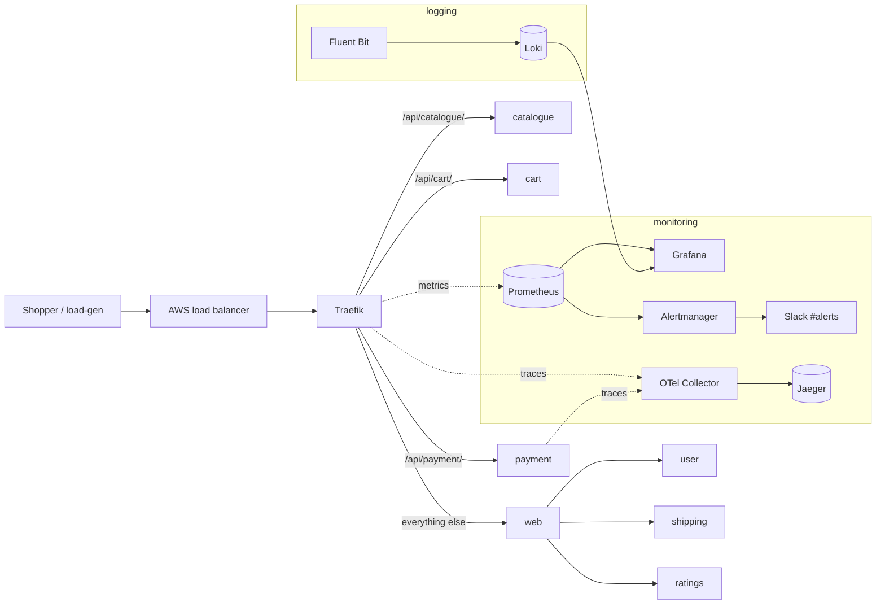

**Why Traefik in front?** Robot Shop's services (2021-era Node 14, Python 3.9) expose no request/error/latency
metrics and are too old for current OpenTelemetry auto-instrumentation. Routing every request through Traefik measures
them **at the edge** with no code changes: per-service RED metrics for Prometheus and a trace for every request.
Traefik is the only public load balancer (web was switched to NodePort).

## Repository layout
| Path | What it is |
|---|---|
| `K8s/helm/` | Robot Shop chart: Instana settings removed, images pinned to `2.1.0`, Redis on `emptyDir`, payment tracing, resource fixes |
| `K8s/load-deployment.yaml` | Load generator (15 simulated shoppers) pointed at Traefik |
| `observability/*-values.yaml` | Pinned Helm values for kube-prometheus-stack, Loki, Fluent Bit, Jaeger, OTel Collector, Traefik |
| `observability/traefik-routes.yaml` | Traefik routes, one per service |
| `observability/slo-rules.yaml` | Availability SLI recording rule and burn-rate alert |
| `observability/dashboards/robot-shop-red.json` | Grafana dashboard as code |
| `docs/` | Runbook, SLO and error budget policy, postmortems, screenshots |

## How to run
Cluster from Capstone 1 with bigger nodes:
```bash
terraform -chdir=../example-voting-app/terraform apply -var node_instance_type=t3.large -var node_count=3
aws eks update-kubeconfig --region eu-north-1 --name voting-app
```
Namespaces and secrets (typed in the terminal, never stored in Git):
```bash
kubectl create namespace monitoring; kubectl create namespace logging
kubectl create namespace traefik; kubectl create namespace robot-shop
kubectl create secret generic grafana-admin -n monitoring --from-literal=admin-user=admin --from-literal=admin-password='...'
kubectl create secret generic alertmanager-slack -n monitoring --from-literal=webhook-url='https://hooks.slack.com/services/...'
```
Install in this order (monitoring first: Traefik's ServiceMonitor needs its CRDs):
```bash
helm install monitoring prometheus-community/kube-prometheus-stack --version 92.11.0 -n monitoring -f observability/monitoring-values.yaml --wait
kubectl apply -f observability/slo-rules.yaml
helm install loki grafana/loki --version 7.3.0 -n logging -f observability/loki-values.yaml --wait
helm install fluent-bit fluent/fluent-bit --version 0.58.3 -n logging -f observability/fluent-bit-values.yaml
helm install jaeger jaegertracing/jaeger --version 4.16.1 -n monitoring -f observability/jaeger-values.yaml
helm install otel-collector open-telemetry/opentelemetry-collector --version 0.177.0 -n monitoring -f observability/otel-collector-values.yaml
helm install traefik traefik/traefik --version 42.1.2 -n traefik -f observability/traefik-values.yaml --wait
helm install robot-shop K8s/helm -n robot-shop
kubectl apply -f observability/traefik-routes.yaml
kubectl apply -f K8s/load-deployment.yaml -n robot-shop
```
Access (private tunnels, no extra load balancers):
`kubectl -n monitoring port-forward svc/monitoring-grafana 3000:80` · `kubectl -n monitoring port-forward svc/jaeger 16686:16686`

Teardown: `helm uninstall traefik -n traefik` (removes the AWS load balancer first), then `terraform destroy`.

## 1. Deploy Robot Shop and watch it
Instana agent settings removed from cart, catalogue, dispatch, payment, user and web; images pinned to `2.1.0`;
Redis uses `emptyDir` (the cluster has no EBS driver, so a volume claim would stay Pending).

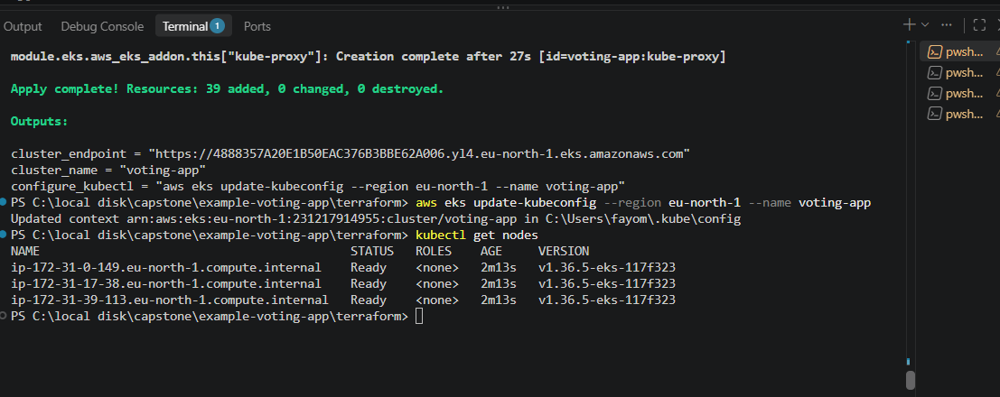
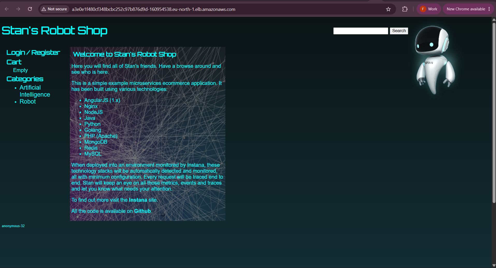

## 2. Metrics: RED dashboard as code
kube-prometheus-stack (Prometheus, Grafana, Alertmanager), small and without persistent disks. Traefik's metrics give
request rate, error rate and p95 latency for web, catalogue, cart and payment, plus the availability SLI.
The dashboard is committed as JSON in `observability/dashboards/`.

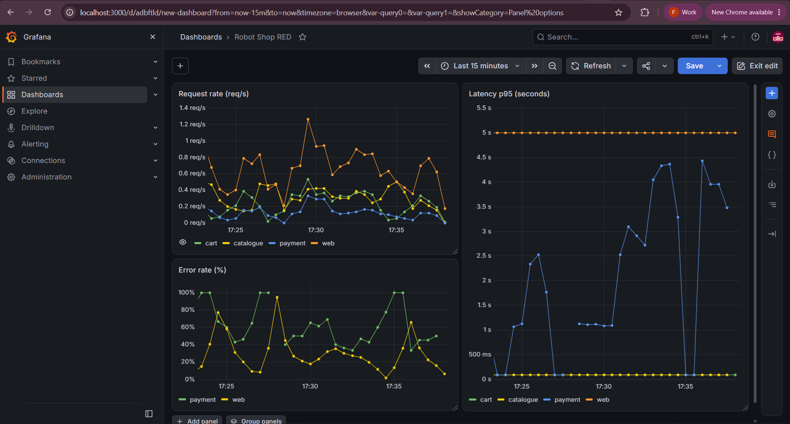

## 3. Logs: Fluent Bit → Loki
Fluent Bit (one per node) reads only `robot-shop` container logs, adds Kubernetes labels, and a small Lua script turns
each service's log style (Node.js numeric levels, Python `INFO in ...`, plain text) into one `level` label.
Searchable by service and level, e.g. `{namespace="robot-shop", app="payment", level="error"}`.

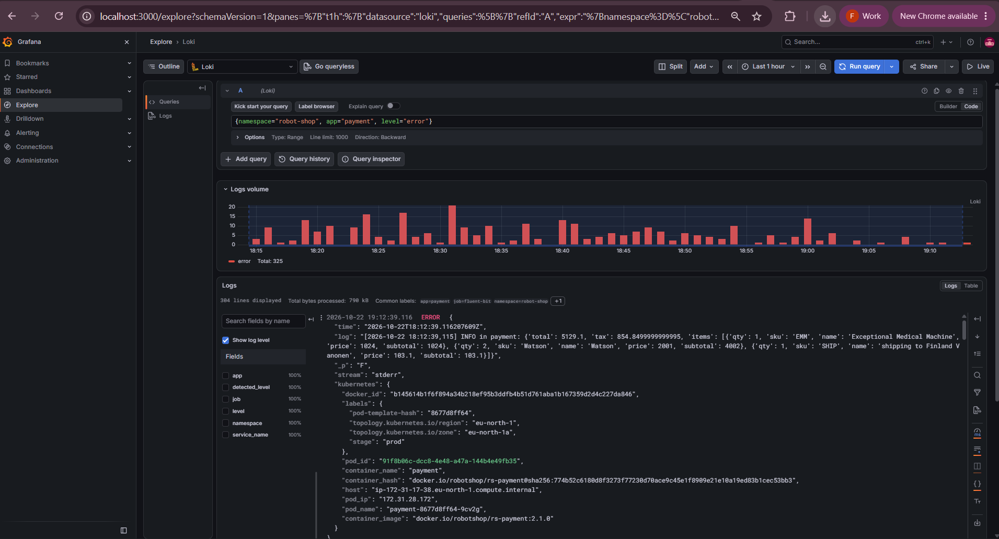

## 4. Traces: OpenTelemetry → Jaeger
Traefik and payment send OTLP traces to the **OpenTelemetry Collector**, which forwards them to Jaeger. Payment gets
tracing with no image rebuild: an init container installs the OTel Python libraries (versions that still support
Python 3.9) and `PYTHONPATH` loads the auto-instrumentation. Traefik's `traceparent` header joins the spans, so one
trace shows **Traefik → payment → user, payment gateway, cart**, and that most of the time is the external gateway.

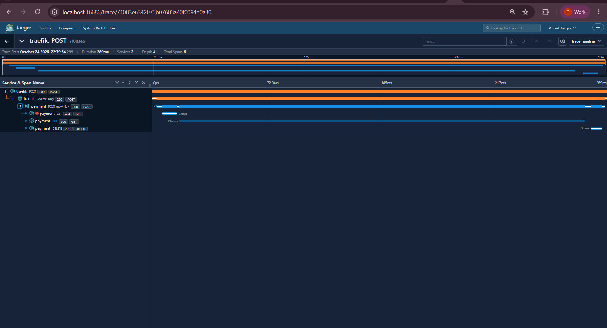

## 5. SLO, error budget and Slack alert
- **SLI:** non-5xx requests ÷ all requests at the Traefik entrypoint. **SLO:** 99% over 30 days (budget ≈ 7.2 hours).
- **Alert:** `RobotShopAvailabilitySLOBurn` when the 5-minute error ratio stays above 14.4% (14.4× burn rate) for 2 minutes.
- Alertmanager sends only SLO alerts to Slack; the webhook comes from a Kubernetes Secret.
- Docs: [SLO and error budget policy](docs/slo-error-budget-policy.md) · [Runbook](docs/runbook.md)

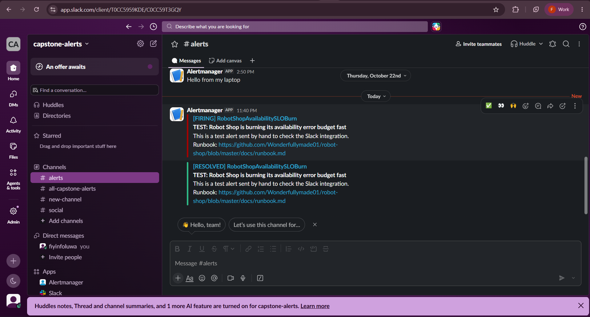
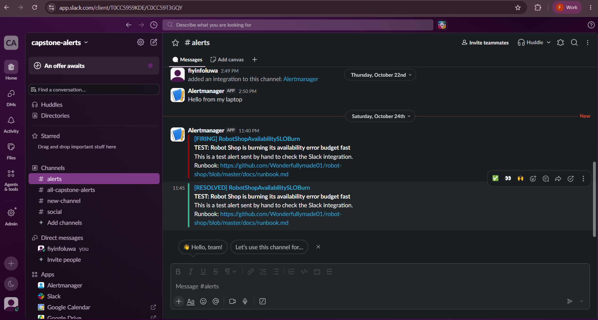

## 6. Incident drill
Catalogue was scaled to zero. The drill showed the first SLI (per-service) **could not see** a service with no pods,
so it was moved to the front door; the alert then fired, one command restored the service, and the alert resolved.
Full write-up: [drill postmortem](docs/postmortem-2026-10-26-drill-catalogue-down.md).

| | |
|---|---|
| 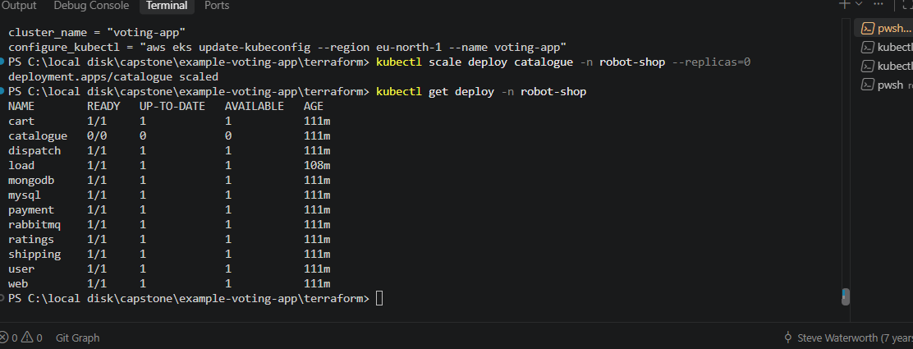 | 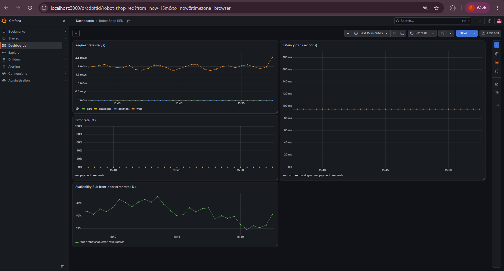 |
| 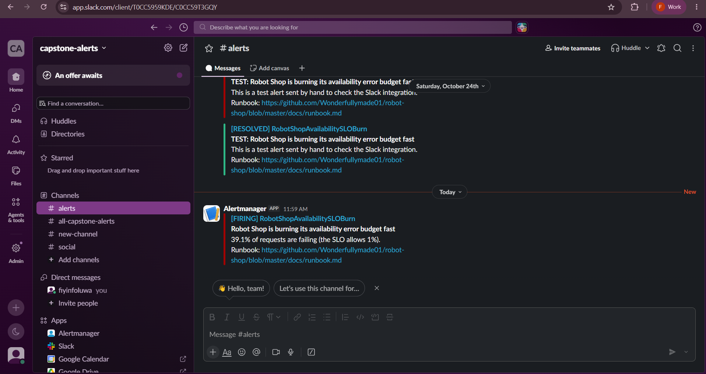 | 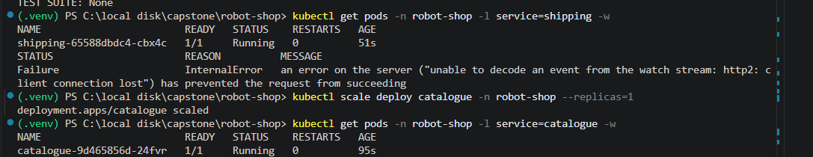 |
| 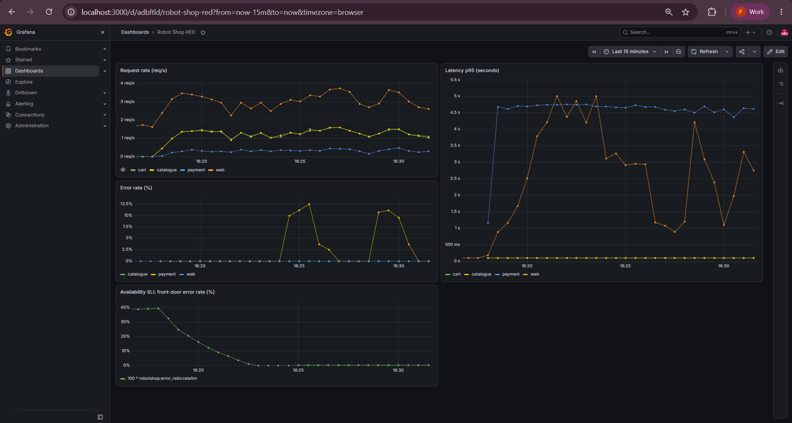 | 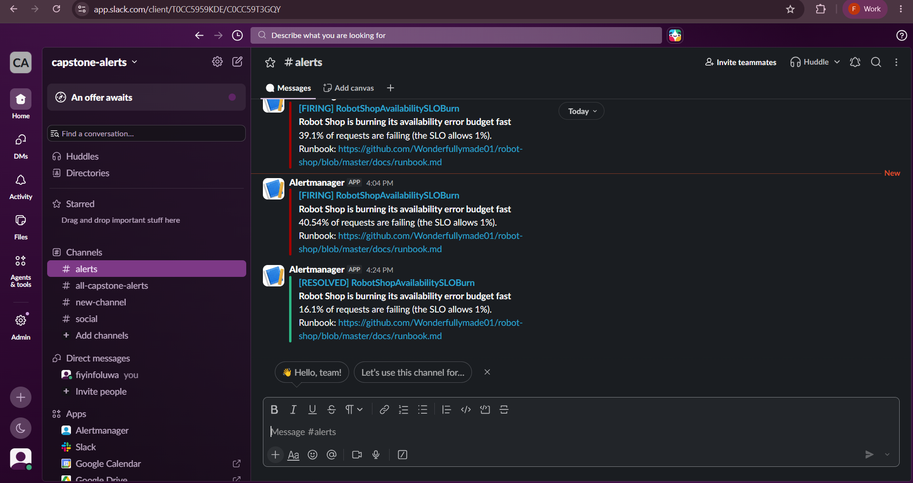 |

## Real incidents found and fixed
| Problem | Root cause | Fix |
|---|---|---|
| ~14% of requests 504 on `/api/ratings/` | EKS node security group allowed node-to-node only on ports 1025-65535; ratings listens on 80 | Terraform rule allowing all node-to-node traffic ([postmortem](docs/postmortem-2026-10-24-ratings-504.md)) |
| Loki crash-looping | Read-only root filesystem, no writable `/var/loki` without persistence | `emptyDir` mounted at `/var/loki` |
| Shipping not ready, 502s | Java `OutOfMemoryError: GC overhead limit` with only 0.2 CPU | 1 CPU limit and `-XX:MaxRAMPercentage=75` |
| Load generator restarting (OOMKilled) | 200 Mi memory limit | 500 Mi |
| Traces lost (404) | OTLP endpoint had `/v1/traces` twice | Base endpoint only for the Python exporter |
| Dashboard and first SLO showed 0% errors while catalogue was down | Per-service metric can't count unroutable requests | Entrypoint-based SLI (drill finding) |

## Known limitations
- No persistent storage: metrics, logs and traces are lost when the cluster is destroyed.
- Payment's external gateway (paypal.com) dominates payment latency; it is outside our control.
- Only payment has in-service tracing; other services are traced at Traefik only.
- The load generator's deliberate error mode is off (`ERROR=0`) to keep a clean baseline.

## Credits
Based on [instana/robot-shop](https://github.com/instana/robot-shop) (Apache 2.0).
